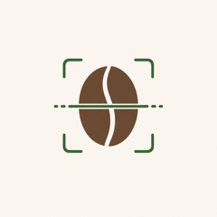
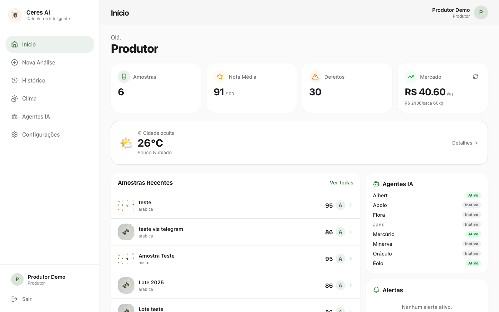
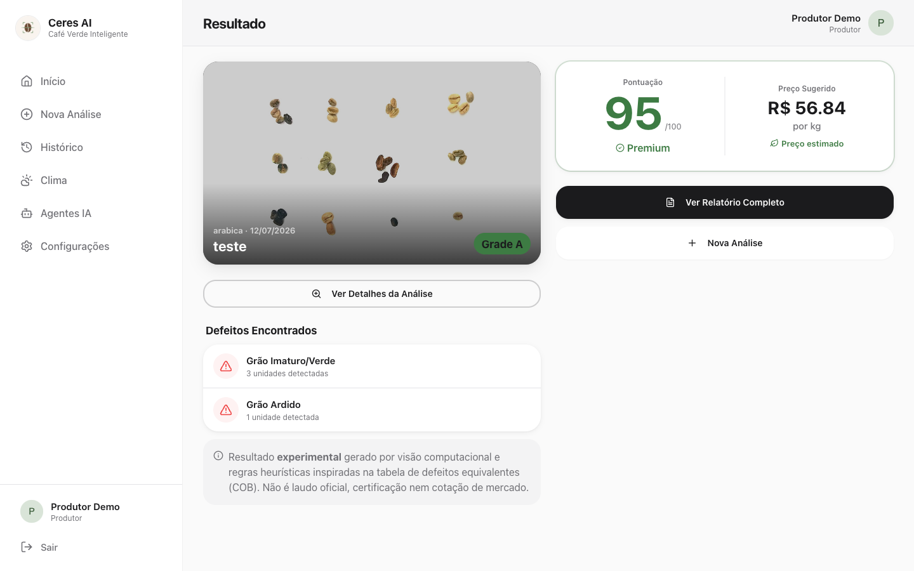
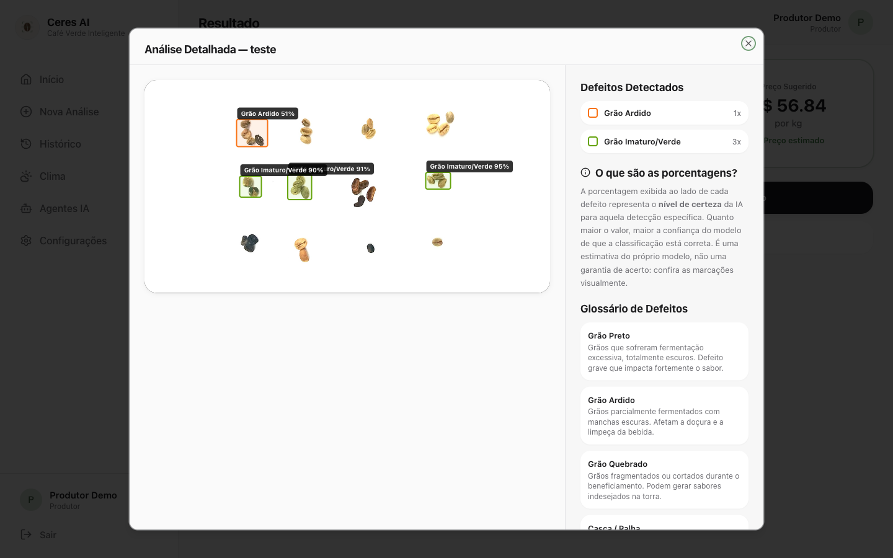
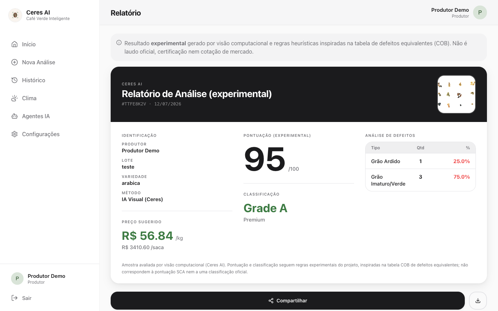
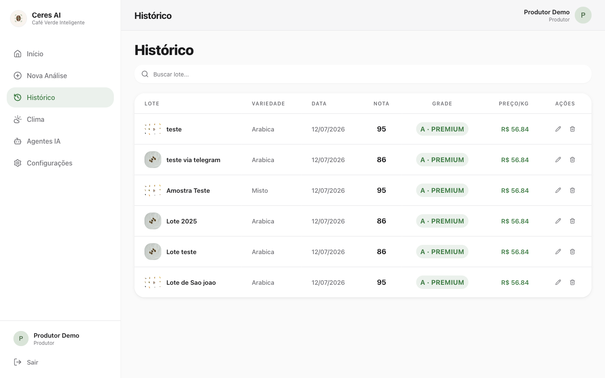
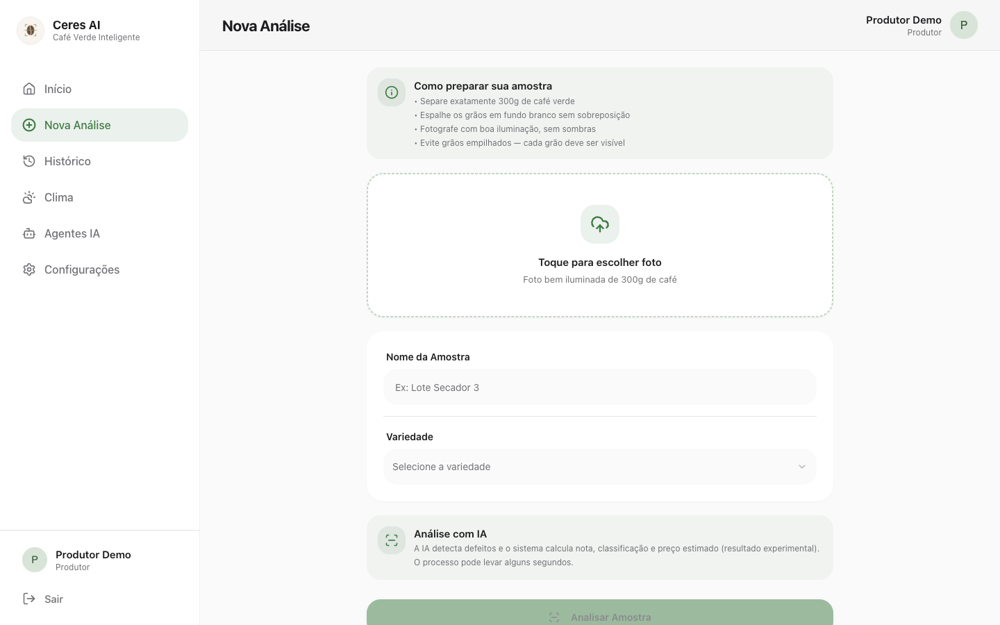
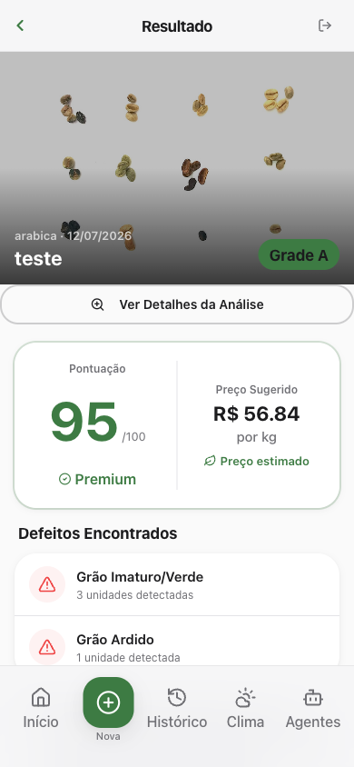
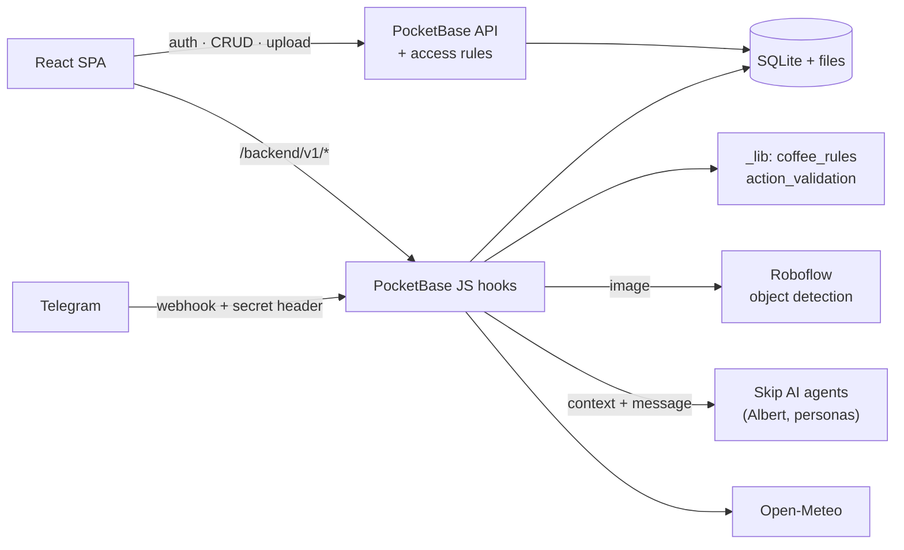

<p align="center">
  
</p>

<h1 align="center">Ceres AI — Intelligent Coffee Quality Analysis</h1>

<p align="center">
  <strong>Computer Vision · AI Agents · Telegram · React · PocketBase</strong>
</p>

<p align="center">
  <a href="https://ceres-ai-coffee-quality.vercel.app"><strong>Live demo</strong></a> ·
  <a href="README.pt-BR.md">Leia em português</a> ·
  <a href="docs/ARCHITECTURE.md">Architecture</a> ·
  <a href="docs/AI_INTEGRATIONS.md">AI integrations</a> ·
  <a href="docs/SECURITY.md">Security</a> ·
  <a href="docs/LIMITATIONS.md">Limitations</a>
</p>

Ceres AI is a hackathon prototype that helps coffee producers get a **fast, experimental first
read on the physical quality of green coffee beans from a photo**. A computer-vision model detects
defective beans, deterministic backend rules convert the detections into a score, a grade and a
suggested price, and an AI assistant named **Albert** explains the results and answers questions
on the web or through Telegram.

**Built by** Antônio José Paes de Andrade Júnior, Evaldo Galdino da Cunha Filho and Rafael
Rodrigues Ferreira Teles — a collective, three-person effort during a hackathon on
[Skip](https://www.goskip.dev/). See [Team](#team).

> **Status:** prototype. Results are experimental and are **not** an official classification,
> certification or market appraisal. See [Limitations](docs/LIMITATIONS.md).

---

## The problem

Physical grading of green coffee is usually done by counting defective beans (black, sour,
broken, insect-damaged…) in a sample and converting them into “equivalent defects”. It is manual,
requires a trained classifier, and small producers often sell without a quick, objective
reference for the quality of a lot.

## The proposed solution

Take a photo of a sample on the phone or in the browser and get, in seconds:

1. **Detected defects** with bounding boxes (object detection via Roboflow).
2. A **score (0–100)** and **grade (A–D)** computed by explicit, testable rules inspired by the
   Brazilian COB equivalent-defects table.
3. A **suggested price per kg** derived from a cached market reference and the grade.
4. An **assistant (Albert)** that explains the numbers, answers questions about the user's samples,
   weather and market data, and — on Telegram — can rename or delete samples after explicit
   confirmation.

## Key features

| Feature | Notes |
| --- | --- |
| Sample registration & photo upload | Web form → PocketBase file storage, owner-only access rules. |
| Defect detection | Roboflow Hosted Inference, 13 class labels (9 defect categories), bounding-box overlay. |
| Deterministic scoring, grading and pricing | `pocketbase/hooks/_lib/coffee_rules.js`, fully unit-tested. |
| Analysis history & report | Per-user history, printable experimental report. |
| Albert assistant (web + Telegram) | Context built server-side from the user's own data; the LLM explains, never computes. |
| Telegram bot | Account linking by one-time deep link, photo analysis, Q&A, confirmed actions. |
| Proactive agents | Hourly persona agents (market, alerts, educator, …) send summaries via Telegram. |
| Weather | Open-Meteo forecast for the producer's registered location. |

## Screenshots

Real captures of the prototype (local build of this repository against the hosted backend; the
account's name, city and photo were masked before capture).

| Dashboard | Result |
| --- | --- |
|  |  |
| **Defect detections (bounding boxes)** | **Experimental report** |
|  |  |
| **History** | **New analysis** |
|  |  |

<p align="center"></p>

## Architecture



Full description, collections, routes and sequence diagrams: [docs/ARCHITECTURE.md](docs/ARCHITECTURE.md).

## Image analysis flow

1. The browser uploads the photo as a new `samples` record (`status = pending`). The API rule
   only accepts it if `user_id` is the signed-in user and no server-computed fields are sent.
2. An after-create hook sends the image to Roboflow (`coffee-bean-defects-nbrvd/1`).
3. `coffee_rules.analyze()` validates the response and computes:
   * equivalent defects per class (e.g. 2 sour = 1, 5 green = 1);
   * grade **A ≤ 4 < B ≤ 12 < C ≤ 26 < D** equivalents and a continuous 0–100 score;
   * price/kg = market reference (R$/60 kg bag ÷ 60) × (1 + **A +40 % · B +15 % · C 0 % · D −25 %**);
   * warnings such as `no_detections`, `low_confidence_detections`, `unknown_classes`.
4. The record is saved as `completed` or `error` (API failure, invalid payload — secrets redacted).
5. The UI polls/subscribes and renders the grade, the experimental notice and the boxes.

Details, before/after of the rules, and an evaluation protocol: [docs/AI_INTEGRATIONS.md](docs/AI_INTEGRATIONS.md).

## Telegram integration

Telegram is an **alternative interface**; all logic runs in the backend.

* The web app issues a one-time, 10-minute deep link that binds a Telegram chat to the account.
* `POST /backend/v1/telegram-webhook` verifies Telegram's `X-Telegram-Bot-Api-Secret-Token`,
  accepts private chats only, validates the payload and de-duplicates `update_id`s.
* A per-chat session collects photo, name, weight and variety, creates the sample, runs the same
  analysis pipeline and asks Albert to present the stored result.

## Albert, the AI agent

Albert runs on Skip's managed agent runtime (`$ai`; the underlying LLM provider is configured by
Skip and not visible in the export). The engineering focus is on **keeping the model on rails**:

* **Grounding:** the backend injects only the authenticated user's inventory, cached market data
  and weather into the prompt; the system prompt forbids inventing data.
* **Separation of concerns:** scores, grades and prices come from tested code; Albert only explains.
* **Deterministic action gate:** proposed actions (`__ACTION__{…}`) are parsed as data, validated
  against an allow-list of types and **fields** (`name`, `variety`, `weight`, `price`), resolved
  only among the caller's own samples, and executed only after the user replies “sim” within
  10 minutes. Every execution or rejection is audit-logged.
* **Web chat** never executes actions.

## Tech stack

| Layer | Technologies |
| --- | --- |
| Frontend | React 19, TypeScript, Vite, React Router 7, Tailwind CSS, shadcn/ui (Radix), Recharts, Zod |
| Backend | PocketBase (JS hooks, migrations, realtime) hosted on Skip |
| AI | Roboflow Hosted Inference (object detection); Skip AI agents (LLM) |
| Integrations | Telegram Bot API, Open-Meteo, BigDataCloud, IBGE |
| Quality | Vitest, TypeScript strict checks, oxlint, pnpm audit |

## Code structure

```text
src/
  pages/            Login, producer pages (dashboard, new analysis, result, report, history, agents, weather), settings
  components/       Dashboard widgets, bounding-box overlay, dialogs, shadcn/ui primitives
  stores/app.tsx    Global samples/alerts state (typed)
  lib/              PocketBase client, domain types, dashboard stats
  services/         Thin API clients
pocketbase/
  migrations/       Schema, access rules, agent definitions (0001–0044)
  hooks/            Custom routes, record hooks, cron, Telegram webhook
  hooks/_lib/       Pure business rules and validation (shared with tests)
tests/
  unit/             Rules, validation, stats, final access rules
  hooks/            Real hook files executed against a mocked PocketBase runtime
  integration/      Live authorization tests (opt-in, staging only)
docs/               Architecture, AI, security, testing, limitations, audit report
```

## Setup

```bash
cp .env.example .env               # set VITE_POCKETBASE_URL
pnpm install --frozen-lockfile     # or: npx pnpm@10 install --frozen-lockfile
pnpm dev
```

The frontend runs anywhere; the **backend requires the Skip runtime** (`$secrets`, `$ai`) and the
secrets listed in [docs/SECURITY.md](docs/SECURITY.md). What works locally and how to run the
backend: [docs/LOCAL_DEVELOPMENT.md](docs/LOCAL_DEVELOPMENT.md).

## Tests

```bash
pnpm test        # 85 unit + hook tests, no network
pnpm check       # typecheck + lint + test + build
pnpm test:live   # authorization tests against a staging PocketBase (opt-in)
```

Coverage includes grade boundaries, pricing and unit conversion, Roboflow failure modes, webhook
authentication and idempotency, agent mass-assignment and cross-user attempts, and the final API
rules. Mocked tests do **not** measure computer-vision accuracy — see [docs/TESTING.md](docs/TESTING.md).

## Security and limitations

A security audit (November 2026) fixed, among others: hardcoded demo credentials, an
unauthenticated Telegram webhook, sample creation on behalf of other users, client-side forgery of
analysis results, and LLM-driven mass assignment. Remaining operational steps (credential
rotation, webhook secret registration) are listed in [docs/SECURITY.md](docs/SECURITY.md) and
[docs/AUDIT_REPORT.md](docs/AUDIT_REPORT.md).

Main limitations: no accuracy benchmark for the vision model; experimental grading and pricing
rules; market cache not refreshed by this code; backend tied to Skip. Full list:
[docs/LIMITATIONS.md](docs/LIMITATIONS.md).

## Prototype status

* Built during a hackathon on Skip; the backend (PocketBase, hooks, agents) runs on Skip.
* Frontend of this repository deployed on Vercel: **https://ceres-ai-coffee-quality.vercel.app**
  (signing up creates an account on the prototype backend; please use test data only).
* No claims of commercial users, validated accuracy, or official grading.

## Team

Ceres AI was designed and built **collectively** by three people, with equal credit:

| | Name | Links |
| --- | --- | --- |
| 👤 | **Antônio José Paes de Andrade Júnior** | [GitHub @AntonioPaess](https://github.com/AntonioPaess) |
| 👤 | **Evaldo Galdino da Cunha Filho** | [GitHub @evaldocunhaf](https://github.com/evaldocunhaf) |
| 👤 | **Rafael Rodrigues Ferreira Teles** | [GitHub @RTels](https://github.com/RTels) |

The Git history is made of automated commits created by the Skip platform and the import into this
repository; it does not reflect individual contributions, and no division of responsibilities is
implied by it.

## Repository history

This public repository starts from a single snapshot of the audited code. The original history —
about 160 automated commits generated by the Skip platform during the hackathon — is kept in a
private archive because it contained a since-removed demo credential.

## Acknowledgements

* The hackathon organisers and mentors.
* [Skip](https://www.goskip.dev/), the platform used to build and host the prototype (React
  scaffold, PocketBase hosting, AI agent runtime and its AI-assisted builder). On top of it, the
  team designed the product, the integrations, the business rules, the computer-vision pipeline and
  the Telegram flow; the testing, security hardening and documentation were added in a
  post-hackathon audit.
* [Roboflow](https://roboflow.com/), [Open-Meteo](https://open-meteo.com/) and the Telegram Bot API.

## License

[MIT](LICENSE) © 2026 Antônio José Paes de Andrade Júnior, Evaldo Galdino da Cunha Filho and Rafael Rodrigues Ferreira Teles — chosen with the agreement of all three authors.
