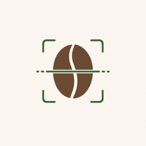
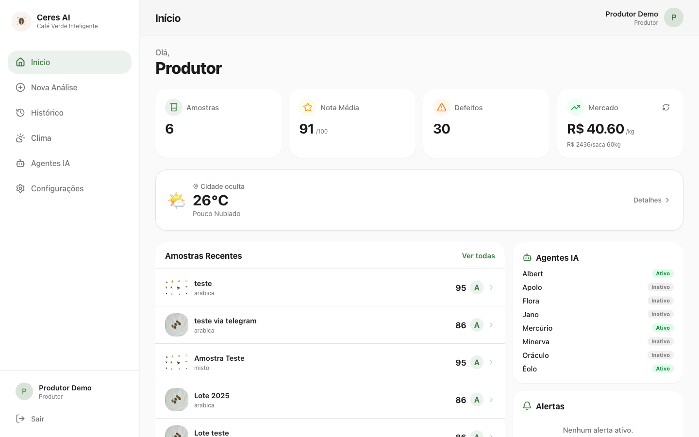
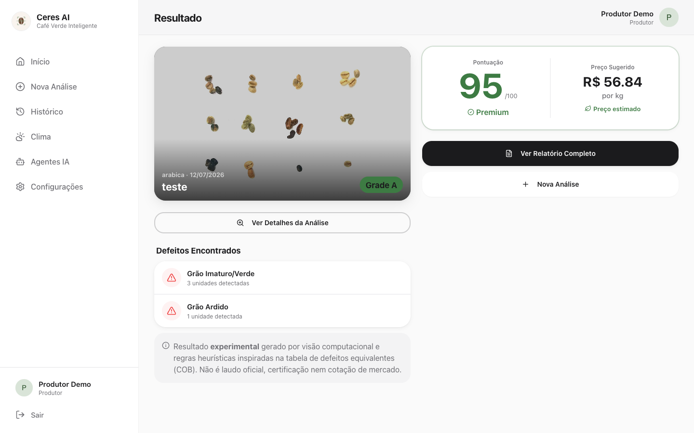
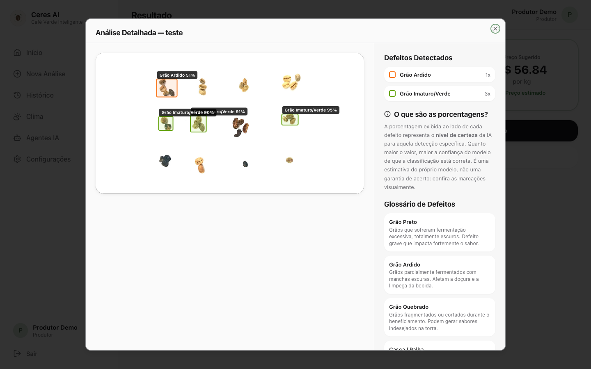
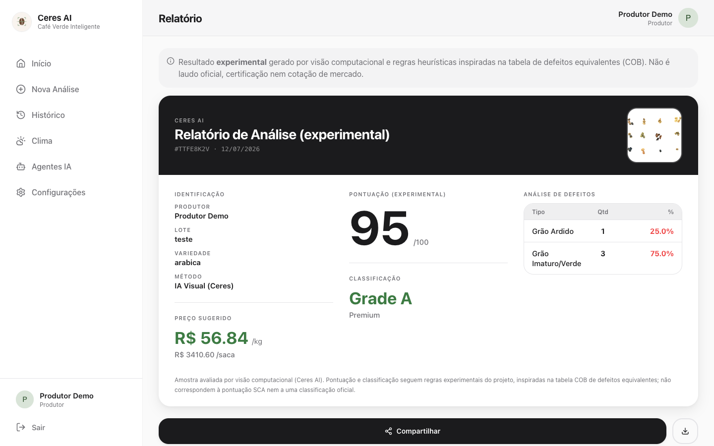
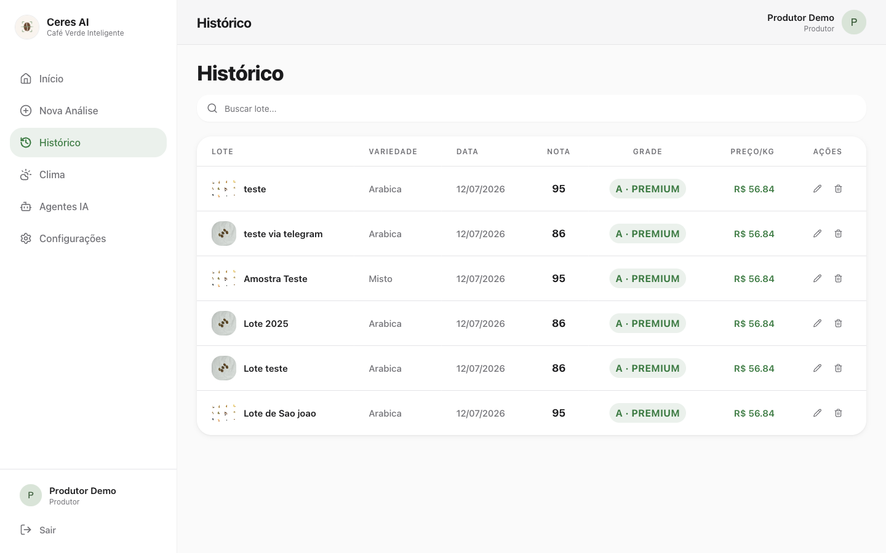
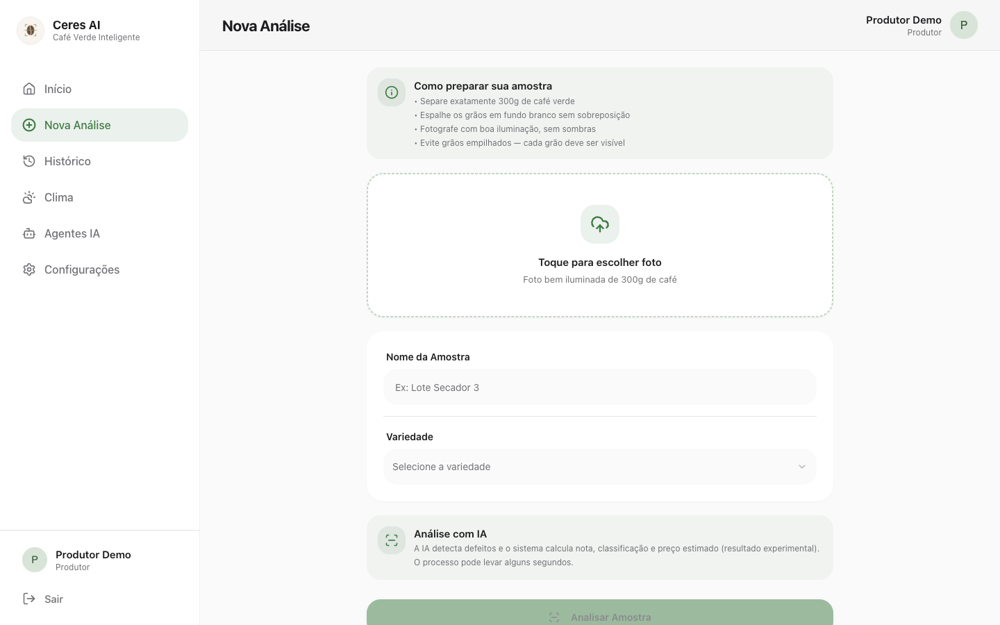
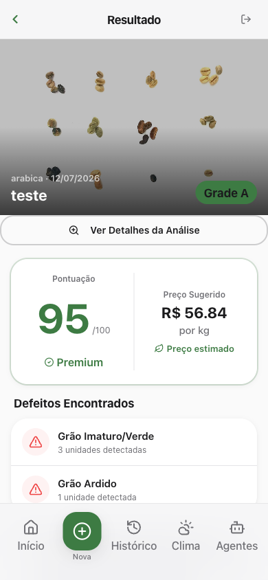
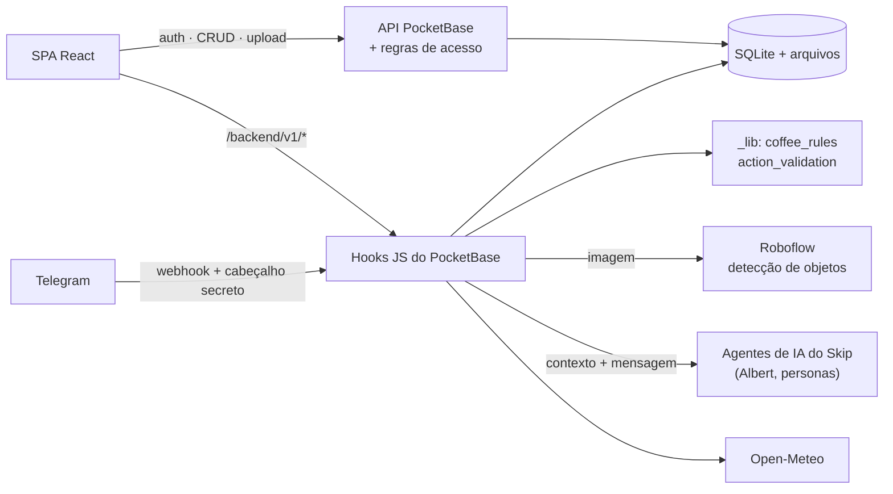

<p align="center">
  
</p>

<h1 align="center">Ceres AI — Análise Inteligente da Qualidade do Café</h1>

<p align="center">
  <strong>Visão Computacional · Agentes de IA · Telegram · React · PocketBase</strong>
</p>

<p align="center">
  <a href="https://ceres-ai-coffee-quality.vercel.app"><strong>Demo</strong></a> ·
  <a href="README.md">Read in English</a> ·
  <a href="docs/ARCHITECTURE.md">Arquitetura</a> ·
  <a href="docs/AI_INTEGRATIONS.md">Integrações de IA</a> ·
  <a href="docs/SECURITY.md">Segurança</a> ·
  <a href="docs/LIMITATIONS.md">Limitações</a>
</p>

O Ceres AI é um protótipo de hackathon que ajuda produtores de café a obter uma **primeira leitura
rápida e experimental da qualidade física de grãos crus a partir de uma foto**. Um modelo de visão
computacional detecta grãos defeituosos, regras determinísticas no backend convertem as detecções
em nota, classificação e preço sugerido, e um assistente de IA chamado **Albert** explica os
resultados e responde perguntas pela web ou pelo Telegram.

**Desenvolvido por** Antônio José Paes de Andrade Júnior, Evaldo Galdino da Cunha Filho e Rafael
Rodrigues Ferreira Teles — trabalho coletivo de três pessoas durante um hackathon na plataforma
[Skip](https://www.goskip.dev/). Veja [Equipe](#equipe).

> **Status:** protótipo. Os resultados são experimentais e **não** constituem classificação
> oficial, certificação ou avaliação de mercado. Veja [Limitações](docs/LIMITATIONS.md).

> A documentação técnica detalhada (pasta `docs/`) está em inglês.

---

## O problema

A classificação física do café cru normalmente é feita contando grãos defeituosos (preto, ardido,
quebrado, brocado…) em uma amostra e convertendo-os em “defeitos equivalentes”. É um processo
manual, que exige um classificador treinado, e pequenos produtores muitas vezes vendem sem uma
referência rápida e objetiva da qualidade do lote.

## A solução proposta

Fotografar uma amostra no celular ou no navegador e obter, em segundos:

1. **Defeitos detectados** com caixas delimitadoras (detecção de objetos via Roboflow).
2. **Nota (0–100)** e **classificação (A–D)** calculadas por regras explícitas e testáveis,
   inspiradas na tabela COB de defeitos equivalentes.
3. **Preço sugerido por kg**, derivado de uma referência de mercado em cache e da classificação.
4. Um **assistente (Albert)** que explica os números, responde sobre as amostras do usuário, clima
   e mercado e — no Telegram — pode renomear ou excluir amostras após confirmação explícita.

## Principais funcionalidades

| Funcionalidade | Observações |
| --- | --- |
| Registro de amostras e upload de fotos | Formulário web → armazenamento no PocketBase, regras de acesso restritas ao dono. |
| Detecção de defeitos | Roboflow Hosted Inference, 13 rótulos de classe (9 categorias de defeito), sobreposição de caixas. |
| Nota, classificação e preço determinísticos | `pocketbase/hooks/_lib/coffee_rules.js`, com testes unitários. |
| Histórico e relatório | Histórico por usuário e relatório experimental imprimível. |
| Assistente Albert (web + Telegram) | Contexto montado no servidor apenas com dados do próprio usuário; o LLM explica, não calcula. |
| Bot do Telegram | Vínculo de conta por link único, análise por foto, perguntas, ações confirmadas. |
| Agentes proativos | Agentes por persona (mercado, alertas, educador…) executados a cada hora, com envio pelo Telegram. |
| Clima | Previsão Open-Meteo para a localização cadastrada. |

## Capturas de tela

Capturas reais do protótipo (build local deste repositório ligado ao backend hospedado; nome,
cidade e foto da conta foram ocultados antes da captura).

| Painel | Resultado |
| --- | --- |
|  |  |
| **Detecções (caixas delimitadoras)** | **Relatório experimental** |
|  |  |
| **Histórico** | **Nova análise** |
|  |  |

<p align="center"></p>

## Arquitetura



Descrição completa, collections, rotas e diagramas de sequência: [docs/ARCHITECTURE.md](docs/ARCHITECTURE.md).

## Fluxo de análise de imagens

1. O navegador envia a foto como um novo registro em `samples` (`status = pending`). A regra da API
   só aceita se `user_id` for o usuário autenticado e nenhum campo calculado pelo servidor for enviado.
2. Um hook pós-criação envia a imagem ao Roboflow (`coffee-bean-defects-nbrvd/1`).
3. `coffee_rules.analyze()` valida a resposta e calcula:
   * defeitos equivalentes por classe (ex.: 2 ardidos = 1, 5 verdes = 1);
   * classificação **A ≤ 4 < B ≤ 12 < C ≤ 26 < D** equivalentes e nota contínua de 0 a 100;
   * preço/kg = referência (R$/saca de 60 kg ÷ 60) × (1 + **A +40 % · B +15 % · C 0 % · D −25 %**);
   * avisos como `no_detections`, `low_confidence_detections`, `unknown_classes`.
4. O registro é salvo como `completed` ou `error` (falha da API, resposta inválida — segredos ocultados).
5. A interface acompanha o status e exibe a classificação, o aviso experimental e as caixas.

Detalhes, antes/depois das regras e protocolo de avaliação: [docs/AI_INTEGRATIONS.md](docs/AI_INTEGRATIONS.md).

## Integração com o Telegram

O Telegram é uma **interface alternativa**; toda a lógica roda no backend.

* A aplicação web gera um link único, válido por 10 minutos, que vincula o chat à conta.
* `POST /backend/v1/telegram-webhook` verifica o cabeçalho `X-Telegram-Bot-Api-Secret-Token`,
  aceita apenas chats privados, valida o payload e descarta `update_id` repetidos.
* Uma sessão por chat coleta foto, nome, peso e variedade, cria a amostra, executa o mesmo pipeline
  de análise e pede ao Albert que apresente o resultado armazenado.

## Albert, o agente de IA

O Albert roda no runtime de agentes gerenciado do Skip (`$ai`; o provedor do LLM é configurado pelo
Skip e não aparece na exportação). O foco de engenharia é **manter o modelo dentro de limites**:

* **Grounding:** o backend injeta no prompt apenas o inventário, o mercado em cache e o clima do
  usuário autenticado; o prompt de sistema proíbe inventar dados.
* **Separação de responsabilidades:** nota, classificação e preço vêm de código testado; o Albert
  apenas explica.
* **Validação determinística de ações:** ações propostas (`__ACTION__{…}`) são tratadas como dados,
  validadas contra uma lista de tipos e de **campos** permitidos (`name`, `variety`, `weight`,
  `price`), resolvidas somente entre as amostras do próprio usuário e executadas apenas após resposta
  “sim” em até 10 minutos. Toda execução ou rejeição é registrada em log de auditoria.
* O **chat web** nunca executa ações.

## Stack tecnológica

| Camada | Tecnologias |
| --- | --- |
| Frontend | React 19, TypeScript, Vite, React Router 7, Tailwind CSS, shadcn/ui (Radix), Recharts, Zod |
| Backend | PocketBase (hooks JS, migrações, realtime) hospedado no Skip |
| IA | Roboflow Hosted Inference (detecção de objetos); agentes de IA do Skip (LLM) |
| Integrações | Telegram Bot API, Open-Meteo, BigDataCloud, IBGE |
| Qualidade | Vitest, verificação de tipos TypeScript, oxlint, pnpm audit |

## Estrutura do código

```text
src/                Páginas, componentes, estado global tipado, clientes de API
pocketbase/
  migrations/       Esquema, regras de acesso, definição dos agentes (0001–0044)
  hooks/            Rotas customizadas, hooks de registro, cron, webhook do Telegram
  hooks/_lib/       Regras de negócio e validações puras (compartilhadas com os testes)
tests/              Unitários, hooks com runtime simulado, integração opcional
docs/               Arquitetura, IA, segurança, testes, limitações, relatório de auditoria
```

## Instalação e configuração

```bash
cp .env.example .env               # defina VITE_POCKETBASE_URL
pnpm install --frozen-lockfile     # ou: npx pnpm@10 install --frozen-lockfile
pnpm dev
```

O frontend roda em qualquer ambiente; o **backend depende do runtime do Skip** (`$secrets`, `$ai`)
e dos segredos listados em [docs/SECURITY.md](docs/SECURITY.md). O que funciona localmente:
[docs/LOCAL_DEVELOPMENT.md](docs/LOCAL_DEVELOPMENT.md).

## Testes

```bash
pnpm test        # 85 testes unitários e de hooks, sem rede
pnpm check       # typecheck + lint + testes + build
pnpm test:live   # testes de autorização contra um PocketBase de homologação (opcional)
```

Testes com respostas simuladas **não** medem a precisão da visão computacional — veja
[docs/TESTING.md](docs/TESTING.md).

## Segurança e limitações

Uma auditoria de segurança (novembro de 2026) corrigiu, entre outros pontos: credenciais de
demonstração fixas no código, webhook do Telegram sem autenticação, criação de amostras em nome de
outros usuários, falsificação de resultados pelo cliente e atribuição em massa de campos via LLM.
As etapas operacionais pendentes (troca de credenciais, registro do segredo do webhook) estão em
[docs/SECURITY.md](docs/SECURITY.md) e [docs/AUDIT_REPORT.md](docs/AUDIT_REPORT.md).

Principais limitações: não há benchmark de precisão do modelo de visão; regras de classificação e
preço experimentais; o cache de cotação não é atualizado por este código; backend acoplado ao Skip.
Lista completa: [docs/LIMITATIONS.md](docs/LIMITATIONS.md).

## Status do protótipo

* Construído durante um hackathon no Skip; o backend (PocketBase, hooks, agentes) roda no Skip.
* Frontend deste repositório publicado na Vercel: **https://ceres-ai-coffee-quality.vercel.app**
  (o cadastro cria uma conta no backend do protótipo; use apenas dados de teste).
* Não há alegação de usuários comerciais, precisão validada ou classificação oficial.

## Equipe

O Ceres AI foi concebido e construído **coletivamente** por três pessoas, com crédito igual:

| | Nome | Links |
| --- | --- | --- |
| 👤 | **Antônio José Paes de Andrade Júnior** | [GitHub @AntonioPaess](https://github.com/AntonioPaess) |
| 👤 | **Evaldo Galdino da Cunha Filho** | _links a adicionar_ |
| 👤 | **Rafael Rodrigues Ferreira Teles** | _links a adicionar_ |

O histórico Git é composto por commits automáticos da plataforma Skip e pela importação para este
repositório; ele não reflete as contribuições individuais nem implica qualquer divisão de tarefas.

## Histórico do repositório

Este repositório público começa em um único snapshot do código auditado. O histórico original —
cerca de 160 commits automáticos gerados pela plataforma Skip durante o hackathon — fica em um
arquivo privado, pois continha uma credencial de demonstração já removida.

## Agradecimentos

* À organização e às mentorias do hackathon.
* Ao [Skip](https://www.goskip.dev/), plataforma usada para construir e hospedar o protótipo
  (estrutura React, hospedagem PocketBase, runtime de agentes e construtor assistido por IA). Sobre
  ela, a equipe definiu o produto, as integrações, as regras de negócio, o pipeline de visão
  computacional e o fluxo do Telegram; testes, reforço de segurança e documentação foram adicionados
  em uma auditoria pós-hackathon.
* Ao [Roboflow](https://roboflow.com/), ao [Open-Meteo](https://open-meteo.com/) e à Telegram Bot API.

## Licença

[MIT](LICENSE) © 2026 Antônio José Paes de Andrade Júnior, Evaldo Galdino da Cunha Filho e Rafael Rodrigues Ferreira Teles — escolhida com o acordo dos três autores.
