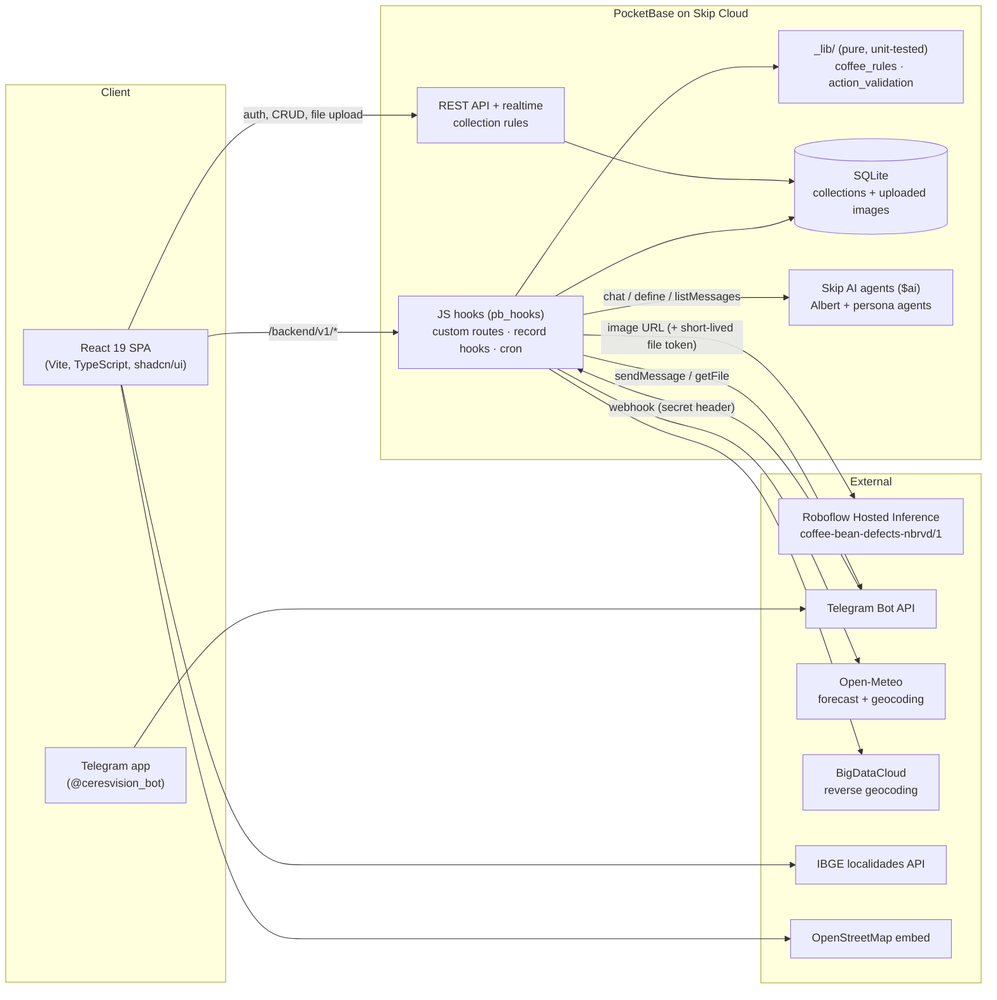
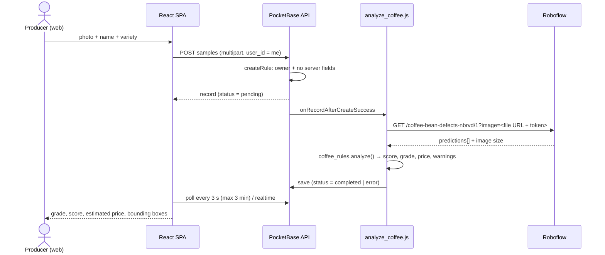

# Architecture

This document describes the system **as implemented in this repository** (Skip export of the
hackathon prototype plus the audit changes). Where behaviour depends on hosted Skip services
that are not part of the export, that is stated explicitly.

## Overview

The Telegram bot is an **alternative interface**. All business logic, persistence, computer-vision
calls and agent orchestration run in the PocketBase backend.

## Components

| Layer | Location | Notes |
| --- | --- | --- |
| Frontend | `src/` | React 19 + React Router 7, shadcn/ui, Tailwind. Global state in `src/stores/app.tsx` (typed via `src/lib/types.ts`). Realtime via PocketBase subscriptions (`src/hooks/use-realtime.ts`). |
| Backend schema | `pocketbase/migrations/` | 44 JS migrations (create collections, rules, seeds, and the Albert prompt versions). |
| Backend logic | `pocketbase/hooks/` | Custom routes (`routerAdd`), record hooks (`onRecord*`), hourly cron (`cronAdd`). |
| Business rules | `pocketbase/hooks/_lib/` | Pure CommonJS modules shared by hooks and tests. Single source of truth for scoring and action validation. |
| AI agents | Skip `$ai` runtime | Agents are *defined* in migrations (`$ai.agents.define`) and called from hooks. The underlying LLM provider/model is configured by Skip (`tier: 'fast'`) and is **not visible in the export**. |

## Collections

| Collection | Purpose | API access (after migration `0042`) |
| --- | --- | --- |
| `users` | Auth collection; `role` (always `producer`), `telegramChatId`, location fields. | PocketBase auth defaults. |
| `samples` | One analysed coffee sample: image, variety, weight, `score`, `grade`, `price`, `defects` (JSON), `status`. | Owner-only list/view/update/delete. Create must set `user_id = auth.id`. Clients cannot write `score`, `grade`, `defects`, `status`, image dimensions; cannot reassign `user_id`. |
| `alerts` | Notifications generated by agents. | Owner-only read; owner may toggle `isRead` only; no client create. |
| `agents` | Agent catalogue (Albert + personas). | Authenticated read; server-only write. |
| `user_agents` | Which agents a user activated, schedule. | Owner-only; create bound to caller. |
| `action_logs` | Audit log of tool/agent actions. | Owner read; **server-only** create. |
| `sessions` | Telegram conversation state machine per chat. | Server-only. |
| `connection_tokens` | One-time, 10-minute tokens to link a Telegram chat to an account. | Server-only. |
| `market_price_cache` | Last coffee quotation (R$/saca). | Server-only. **No code in this export writes to it** — see [LIMITATIONS](LIMITATIONS.md). |
| `telegram_updates` | Idempotency log of processed Telegram `update_id`s (unique index). | Server-only (new, `0044`). |

## Custom routes (`/backend/v1/*`)

All routes require authentication except the Telegram webhook, which is authenticated by the
`X-Telegram-Bot-Api-Secret-Token` header.

| Method | Route | Hook |
| --- | --- | --- |
| POST | `/telegram-webhook` | `telegram_webhook.js` |
| POST | `/telegram/connect` | `telegram_connect.js` |
| POST | `/albert/chat` · GET `/albert/chats` · GET `/albert/chats/{id}/messages` | `albert_chat.js`, `albert_chats_list.js`, `albert_messages.js` |
| GET | `/albert/market` · `/albert/weather` | `albert_market.js`, `albert_weather.js` |
| GET | `/agents` · POST `/agents/{id}/activate` · `/deactivate` · `/agents/test` | `agents_*.js` |
| POST | `/agents/custom` | Returns `410 Gone` (feature disabled). |
| GET / POST | `/market-price` · `/market-price/refresh` | Reads the cache (refresh does **not** call an external source). |
| POST | `/geocode` | `geocode_user.js` (Open-Meteo geocoding). |

Record hooks: `on_sample_create.js` (forces `status = pending`), `analyze_coffee.js` (inference
after create), `albert_monitor.js` (alert on score drop). Cron: `agents_run.js` (hourly persona
agents → alerts).

## Data flows (verified against the code)

### A — Dashboard analysis

The inference call is **synchronous inside the after-create hook** (timeout 120 s), so the record
is created first and enriched afterwards; the UI polls until `status` leaves `pending`.

### B — Telegram analysis

1. Telegram → `POST /backend/v1/telegram-webhook`.
2. Hook verifies the secret header (fail-closed), validates the update (private chat only,
   bounded text) and records `update_id` for idempotency.
3. The chat is resolved to a user through `users.telegramChatId` (linked earlier via a one-time
   `connection_tokens` deep link generated in the web app). Unlinked chats only receive onboarding.
4. A `sessions` record holds the conversation state (`awaiting_name`, `analyzing`, temp photo,
   weight, variety). Missing data is collected through Albert or an inline variety keyboard.
5. The photo (largest size ≤ 10 MB) is downloaded from Telegram and saved as a new `samples`
   record → the same `analyze_coffee.js` hook runs → Albert is asked to *present* the stored result.

### C — Questions (web chat and Telegram)

`albert_chat.js` / `chatWithAlbert` detect intent with **keyword lists** (market, weather,
inventory). Matching data is loaded server-side **only for the authenticated user** (filters by
`user_id`) and prepended to the message as a context block; the agent answers from it.
Conversation scoping relies on Skip's `$ai` API receiving the `user_id`.

### D — Actions (edit / delete / agent activation)

The model may emit `__ACTION__{json}__`. On **Telegram** the backend:

1. parses the JSON and validates it deterministically (`action_validation.validateAction`):
   allowed type, well-formed target, **field whitelist** (`name`, `variety`, `weight`, `price`);
2. stores it as `pendingAction` and asks the user to answer *sim/não*;
3. on *sim*, re-validates (incl. a 10-minute TTL), resolves the target **only among the caller's
   samples**, re-checks ownership and executes; every outcome is written to `action_logs`.

On the **web chat**, action markers are stripped from the reply and **not executed**; edits and
deletes happen through the regular UI under PocketBase rules.

## Git history and authorship

The repository history consists of ~156 automated commits authored by the Skip platform
("Skip &lt;skip@…&gt;", versions `v0.0.x`) plus the import commits. **Commit authorship does
not reflect the individual contributions of the three team members**; the project was built
collectively inside Skip during the hackathon.
